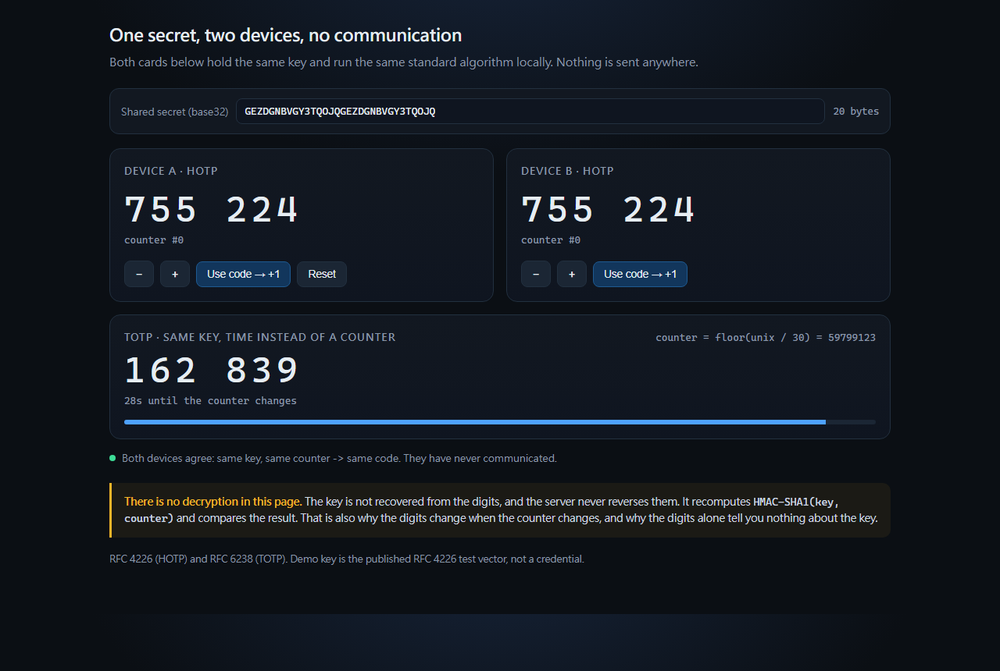

# 4220 DUO Demo

A small, self-contained demonstration of **how one-time passcodes (OTP) actually work** - the
mechanism behind authenticator apps and hardware tokens.

No dependencies. No network. No account. No secret.

The key used everywhere in this repo is the **published RFC 4226 test vector**
(`base32("12345678901234567890")`). It is public test data and cannot log in to anything.

```bash
node demo/demo-step.mjs      # one passcode, every intermediate value
node demo/demo-counter.mjs   # 10 codes, checked against the RFC
node demo/demo-window.mjs    # how a server accepts / rejects them
npm test                     # 15 checks against RFC 4226 + RFC 6238 vectors
```

Then open **[demo/demo.html](demo/demo.html)** in a browser (or double-click `run-demo.cmd` on Windows).



---

## 1. What this is, and what it is not

**Is:** the standard HOTP (RFC 4226) and TOTP (RFC 6238) algorithms, written from scratch in
~100 lines, with every intermediate value exposed so the mechanism can be shown on a screen.

**Is not:** an authenticator app, a login tool, or anything that talks to a real service. There is
no enrolment, no server, no credential, and nothing here can authenticate to anything.

Everything runs offline. The two "devices" in the browser page never communicate - that is the
point of the demonstration.

---

## 2. The OTP session, step by step

An OTP system has three phases. Only the first one uses a network, and only the first one involves
anything cryptographic in the *confidentiality* sense.

| Phase | When | What happens | Network |
|---|---|---|---|
| **Enrolment** | once | the server and the device agree on a **shared secret** | yes, over TLS |
| **Generation** | every login | the device computes `HOTP(secret, counter)` locally | **none** |
| **Verification** | every login | the server computes the same thing and compares | yes |

That is the whole system. There is no message passing at login time - just two parties doing the
same arithmetic on the same secret.

### 2.1 Enrolment: getting the shared secret

The server generates a random secret and gives it to the device once:

```
server                                      device
  |                                           |
  |  1. generate random secret K              |
  |  2. show it once, over TLS  ------------->|  store K
  |  3. keep K                                |  keep K
  |                                           |
  |  4. both sides set counter C = 0          |
```

After this step the secret never moves again. This is why the secret is the whole ballgame: whoever
holds `K` can generate valid codes forever.

### 2.2 Generation: one hash, one counter

The 6-digit code is not random, and it is not stored anywhere. It is **computed**:

```
code = HOTP(K, C) = Truncate( HMAC-SHA1(K, C) ) mod 10^6
```

`demo-step.mjs` prints each step with real values. Here is counter 0 with the RFC test key:

| Step | What | Value |
|---|---|---|
| 1 | shared secret, base32 | `GEZDGNBVGY3TQOJQGEZDGNBVGY3TQOJQ` |
| | decode it | `31323334...3930` (20 bytes) |
| 2 | counter as 8 bytes, big-endian | `0000000000000000` |
| 3 | `HMAC-SHA1(key, counter)` | `cc93cf18508d94934c64b65d8ba7667fb7cde4b0` |
| 4 | offset = last byte & `0x0f` | `0xb0 & 0x0f` = **0** |
| 5 | 4 bytes at offset, top bit cleared | `cc93cf18` -> `4c93cf18` = **1284755224** |
| 6 | mod 10^6 | **755224** |

Step 4 and 5 are the only non-obvious part. The digest is 20 bytes but the code must be short, so
RFC 4226 says: use the last byte to pick a starting position (0-15), take 4 bytes from there, and
clear the top bit so the number is always positive. This is called **dynamic truncation**.

### 2.3 Verification: recompute, do not decrypt

The server receives `755224` and does this:

```
server:  HOTP(K, C) = 755224   ==   received 755224   ->  accept
```

It never reverses the code. It cannot - HMAC is one-way, and a 6-digit number carries no
information about the key. If the counters differ by a few steps, the server tries a small window
of counters ahead of the last one it accepted (see section 5).

---

## 3. HOTP vs TOTP: same algorithm, different counter

This is the single most useful thing to take away. **TOTP is not a different algorithm.** It is
HOTP with a counter computed from the clock:

```
HOTP:  C = 0, 1, 2, 3, ...                       (one step per use)
TOTP:  C = floor(unix_seconds / 30)              (one step per 30 s)
```

| | HOTP (RFC 4226) | TOTP (RFC 6238) |
|---|---|---|
| Counter source | incremented on each use | `floor(time / period)` |
| State to keep | **yes** - the counter, per device | no (just the clock) |
| Survives reboot / new device | only if the counter is carried over | yes, automatically |
| Code lifetime | until used | fixed (usually 30 s) |
| Typical use | hardware tokens, printed backup codes | phone authenticator apps |

Because TOTP needs no stored state, it is what apps default to. Because HOTP survives with no clock
and no battery, it is what hardware tokens use.

Both are in this repo: the CLI demos use HOTP, the third card in `demo.html` and the RFC 6238 tests
use TOTP over the *same* key, so the difference is visible side by side.

---

## 4. "Where is the encryption?" - the part that trips everyone up

People expect encryption and decryption. There is neither in the code path. Three things look like
encryption but are not:

| Thing | What it really is | Reversible without a key? |
|---|---|---|
| **base32** | an *encoding*, so bytes fit in text | **yes** - decode it and you have the key |
| **HMAC-SHA1** | a *one-way* keyed hash (a MAC) | no - that is the point |
| **the 6-digit code** | a truncated hash, 10^6 possible values | no, and it carries no data |
| **TLS at enrolment** | real encryption, of the transport | only by breaking TLS |

So:

- **The code is never decrypted.** The verifier recomputes it and compares. "Recompute and
  compare", not "decrypt".
- **The stored secret is not encrypted** by the algorithm. Storing it safely (OS keychain, file
  permissions) is a separate, operational problem.
- **There is no "decryption key"** anywhere in an OTP system. One secret, used in one direction.

Why is 6 digits enough? Not because the code is strong - there are only a million of them - but
because it is single-use, short-lived, rate-limited, and useless without the secret. The security
lives in the secret, not in the digits.

---

## 5. Why the counter is the hard part

HOTP only works if both sides agree on `C`. The server remembers the last counter it accepted, so:

- a code **at or ahead** of that counter can be valid (within a small window);
- a code **behind** it is dead forever;
- a code **already used** is dead forever.

`demo/demo-window.mjs` simulates exactly this:

```
first login               counter   0  code 755224  ->  ACCEPT
same code again           counter   0  code 755224  ->  REJECT
next login                counter   1  code 287082  ->  ACCEPT
an old code               counter   0  code 755224  ->  REJECT
client jumped ahead       counter   6  code 287922  ->  ACCEPT  (skipped 4)
client jumped way ahead   counter  40  code 268376  ->  REJECT
normal login after that   counter   7  code 162583  ->  ACCEPT
```

Consequences that show up in every real HOTP deployment:

1. **Skipping forward is safe** (inside the window) and costs nothing.
2. **Falling behind is fatal** until the client walks forward.
3. The counter is **per device**, so two clients with the same secret can drift apart - and then
   the one that is behind starts failing.

---

## 6. Files

```
demo/otp.mjs            HOTP + TOTP + a verifier; Node built-ins only
demo/demo-step.mjs      one code, every intermediate value, annotated
demo/demo-counter.mjs   10 codes checked against RFC 4226 Appendix D
demo/demo-window.mjs    server simulation: used / stale / skipped / too-far codes
demo/demo.html          browser demo: two devices, shared secret, live TOTP
demo/DEMO-SCRIPT.md     what to say, in what order, with timings
tests/test-otp.mjs      15 checks: RFC 4226, RFC 6238, encodings, window logic
run-demo.cmd            Windows: runs everything and opens the page
run-demo.sh             macOS / Linux equivalent
```

---

## 7. Verify it

```bash
npm test
```

```
  PASS  HOTP counters 0-9 match RFC 4226 Appendix D
  PASS  truncation uses the RFC offset rule on a known digest
  PASS  TOTP matches RFC 6238 SHA-1 test vectors
  PASS  verifier accepts a code inside the window and reports the skip
  ...
  15 checks passed
```

The tests compare against **published vectors**, not against the implementation itself. If they
pass, the codes are the real algorithm - which is exactly the claim a demo like this has to earn.

---

## 8. Scope and safety

- The demo key is a **published test vector**. It is not a credential and authenticates to nothing.
- Nothing here enrols a device, contacts a server, or stores a secret.
- This repo is about understanding the mechanism. It deliberately does not implement the
  account-provisioning side of any real OTP deployment.

RFC 4226 (HOTP), RFC 6238 (TOTP), RFC 4648 (base32).

MIT licensed.
